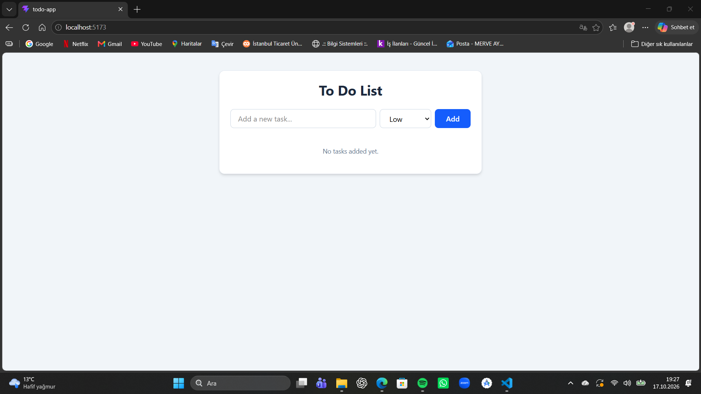
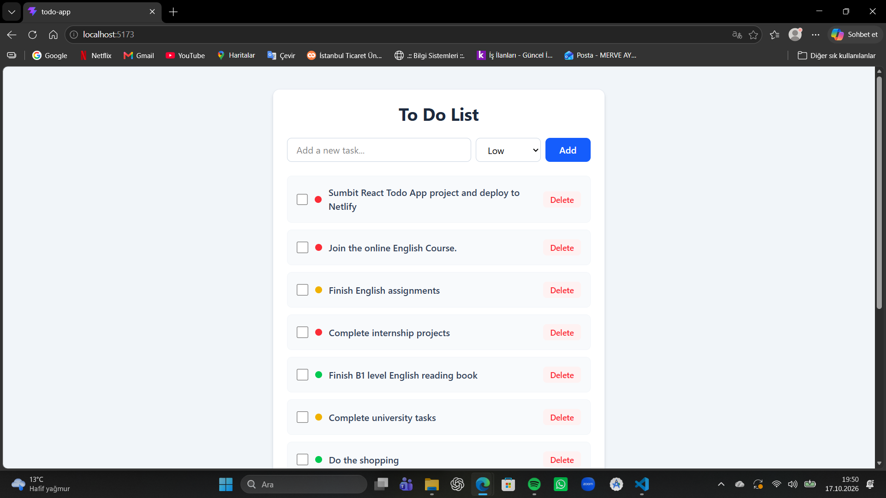
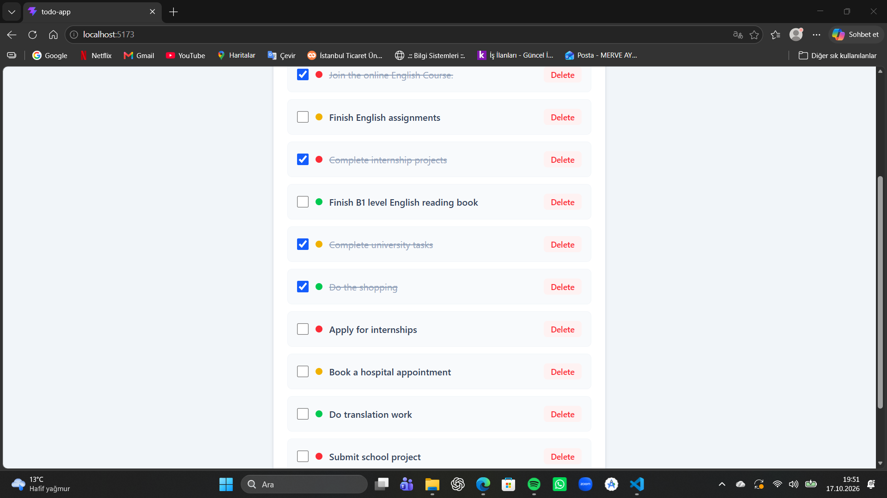
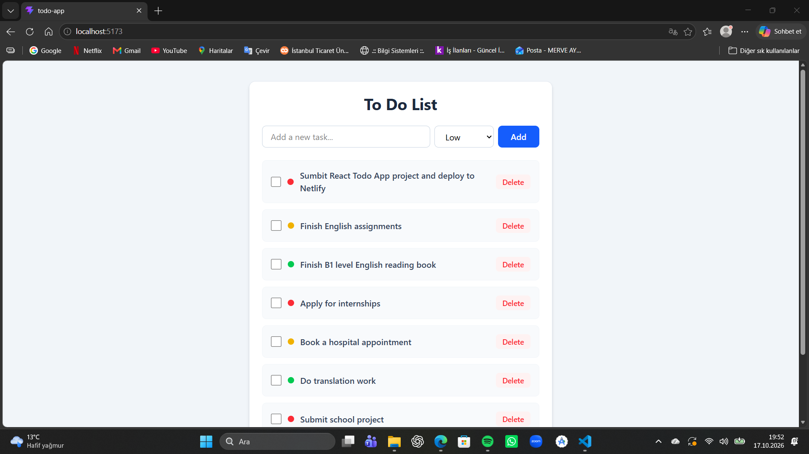

# 📝 React Görev Takip Uygulaması (Todo App)

Modern web teknolojileri kullanılarak geliştirilmiş, görevlerinizi öncelik sırasına göre takip edebileceğiniz ve verilerinizi tarayıcınızda güvenle saklayan bir görev yönetim uygulamasıdır.

## 🚀 Özellikler (Features)
- **Görev Ekleme (Create):** Farklı öncelik seviyelerine (High, Medium, Low) sahip yeni görevler oluşturma.
- **Listeleme (Read):** Eklenen görevleri şık ve okunaklı bir arayüzde görüntüleme.
- **Güncelleme (Update):** Tek tıkla (checkbox) görevleri tamamlandı/tamamlanmadı olarak işaretleme.
- **Silme (Delete):** İstenmeyen veya tamamlanan görevleri listeden kaldırma.
- **Veri Kalıcılığı:** LocalStorage entegrasyonu sayesinde sayfa yenilense bile verilerin kaybolmaması.
- **Dinamik Renkler:** Öncelik durumuna göre değişen rozet (badge) tasarımları.

## 🛠️ Kullanılan Teknolojiler (Tech Stack)
- **Frontend Framework:** React.js (Vite ile oluşturuldu)
- **Stil Kütüphanesi:** Tailwind CSS
- **Veritabanı:** Tarayıcı LocalStorage API
- **Sürüm Kontrolü:** Git & GitHub

## 📸 Ekran Görüntüsü









## 💻 Kurulum ve Çalıştırma (Installation)

Projeyi kendi bilgisayarınızda çalıştırmak için aşağıdaki adımları izleyebilirsiniz:

1. Repoyu bilgisayarınıza klonlayın:
   ```bash
   git clone [https://github.com/KULLANICI_ADIN/todo-app.git](https://github.com/KULLANICI_ADIN/todo-app.git)

2. Proje dizinine girin:
    ```bash
    cd todo-app

3. Bağımlılıkları yükleyin:
    ```bash
    npm install

4. Geliştirici sunucusunu başlatın:
    ```bash
    npm run dev

## ✉️ İletişim

Merve Aydın

GitHub: @merveAydinDev